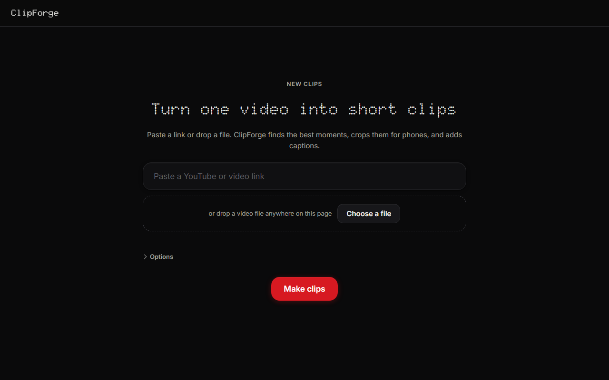
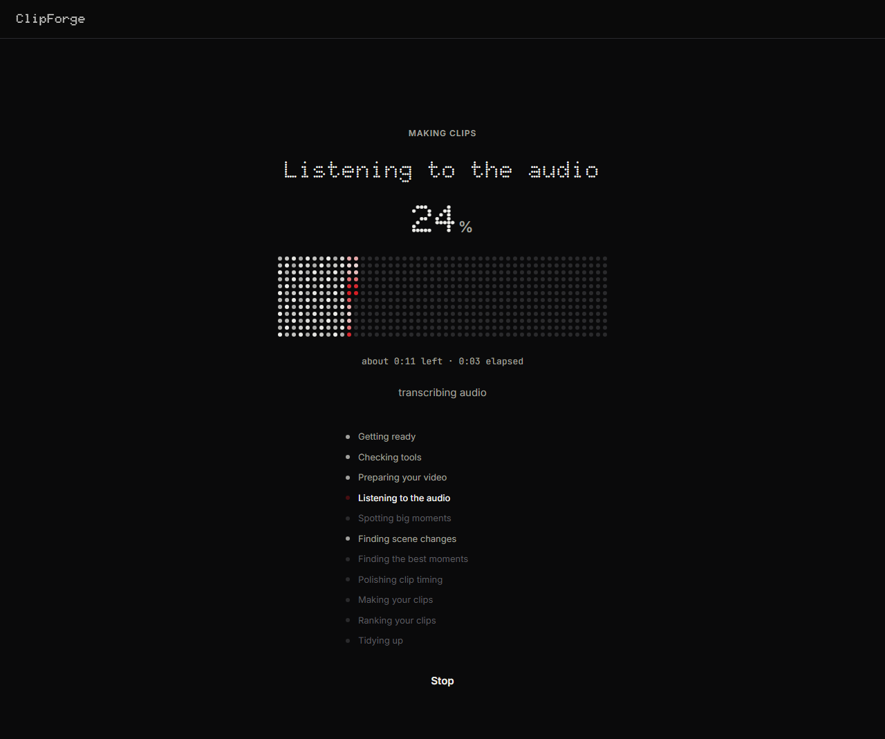
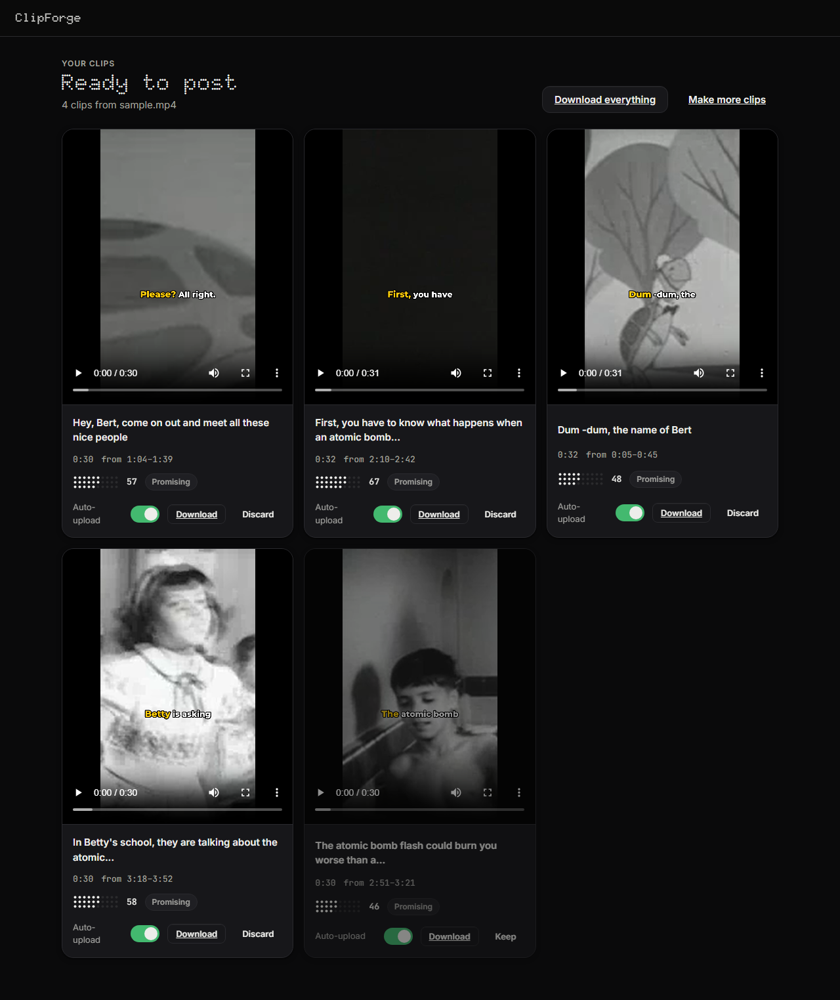
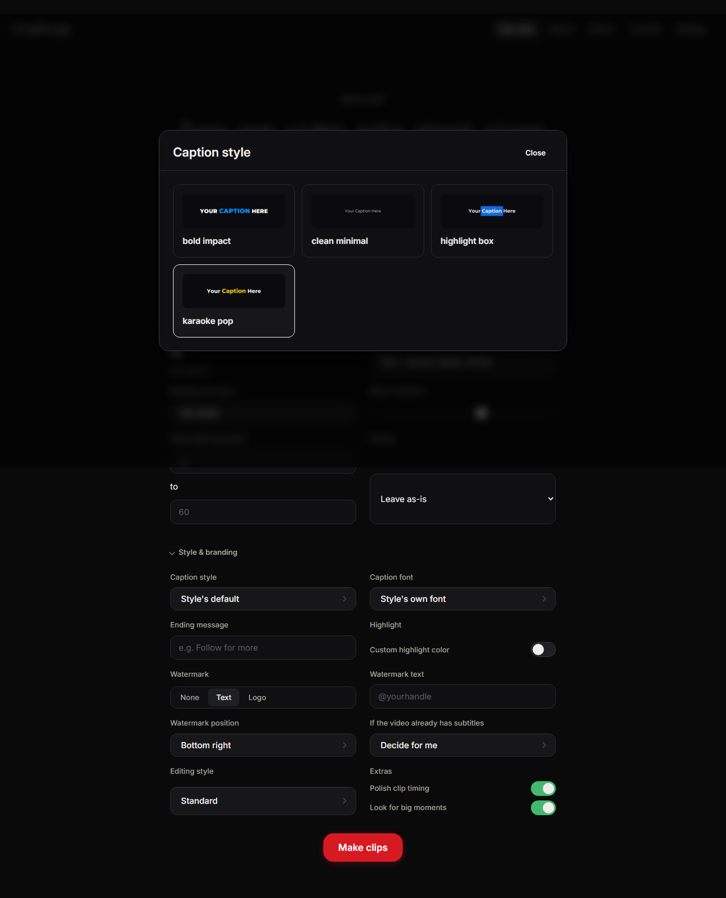

# ClipForge 🎬⚡

**100% Free, Fully Local AI Video Clipping Application for Windows**

ClipForge transforms long-form videos (YouTube URLs or local files) into viral, short-form vertical videos (9:16, 1:1, or 16:9) formatted for YouTube Shorts, Instagram Reels, and TikTok. 

Powered entirely by **local AI models and GPU acceleration**—with **zero mandatory cloud API keys, zero subscription fees, and 100% local data privacy**.

---

## 1. Features

- **Dual-Source Ingestion:** Instant YouTube video inspection & streaming download (`yt-dlp`) plus drag-and-drop local video file upload (supports MP4, MKV, MOV, WebM, AVI, FLV, M4V, TS, WMV).
- **Local Speech-to-Text:** Fast, word-level audio transcription using **Faster-Whisper** on NVIDIA CUDA (`small` / `large-v3` models).
- **Local AI Viral Moment Detection:** Finds punchy, high-retention segments using local **Ollama** (`llama3.2:3b` / `llama3.1`). Automatically falls back to deterministic rule-based scoring if the local LLM is unavailable.
- **AI Social Package:** Automatically drafts engaging social media titles, descriptions, and hashtags tailored for TikTok, Reels, and Shorts.
- **Smart Face Tracking & Reframing:** MediaPipe 2D face mesh and active-speaker tracking dynamically crops 16:9 widescreen footage into 9:16 vertical or 1:1 square videos with smooth exponential motion stabilization.
- **Animated Karaoke Subtitles:** Generates word-by-word synchronized subtitles rendered via FFmpeg `libass` with selectable presets (`karaoke-pop`, `bold-impact`, `clean-minimal`, `highlight-box`) using bundled OFL Montserrat typography.
- **Audio Ducking & Normalization:** Dual-filter chain ducks background music under spoken dialogue and normalizes overall audio levels to `-14 LUFS` (EBU R128 standard).
- **NVIDIA GPU Acceleration:** Fast video encoding using `h264_nvenc` on NVIDIA RTX GPUs (~3–5s per 15s clip) with automatic fallback to CPU `libx264`.
- **Modern Web Dashboard:** Chromeless local desktop UI running on `http://127.0.0.1:7860` with real-time WebSocket progress, live log console, interactive video players, one-click social copying, individual clip downloads, full-project ZIP export, and searchable run history.

---

## 2. Application Screenshots

| Dashboard & Upload | Progress & Real-time Logs |
| :---: | :---: |
|  |  |

| Multi-Clip Results & Social Copy | Subtitle Preset & Music Pickers |
| :---: | :---: |
|  |  |

> **Note on Screenshots:** Screenshots shown above are sourced from the `design/screenshots/` design reference folder. To capture and update real screenshots from your own live runs, launch ClipForge via `run.bat`, generate a sample batch, and save screenshots directly into `design/screenshots/`.

---

## 3. Hardware Requirements

| Component | Minimum Specification | Recommended Specification (Tested Environment) |
| :--- | :--- | :--- |
| **Operating System** | Windows 10/11 64-bit | Windows 11 Home 64-bit |
| **Processor (CPU)** | Intel Core i5 / AMD Ryzen 5 (4+ cores) | Intel Core i7-13650HX (14 cores, 20 threads) |
| **Graphics (GPU)** | NVIDIA GTX 1060 (6GB VRAM) or CPU | NVIDIA GeForce RTX 5050 / 4060+ (8GB VRAM, NVENC) |
| **System Memory** | 16 GB DDR4/DDR5 | 16 GB+ DDR5 |
| **Storage** | 10 GB free SSD space | 25 GB+ NVMe SSD |

---

## 4. Software Prerequisites

Before starting, ensure the following core tools are installed on your Windows machine:

1. **Python 3.11 (64-bit):**
   - Download: [Python 3.11.9](https://www.python.org/downloads/release/python-3119/)
   - *Important:* Ensure "Add python.exe to PATH" is checked during installation.
   - *Location:* Typically installed at `%LOCALAPPDATA%\Programs\Python\Python311\python.exe`.
2. **NVIDIA GPU Driver:**
   - NVIDIA Driver 550+ (Tested on 610.74, CUDA 13.3 capability).
3. **Ollama for Windows:**
   - Download & Install: [https://ollama.com/download/windows](https://ollama.com/download/windows)
4. **Git for Windows (Optional):**
   - Download: [https://git-scm.com/download/win](https://git-scm.com/download/win)

---

## 5. Quick Start (Windows 11)

### Step 1: Environment Diagnostic Check
Open PowerShell inside the project directory and run:
```powershell
powershell -ExecutionPolicy Bypass -File .\check-environment.ps1
```
This diagnostic script checks all 15 hardware, driver, Python, FFmpeg, CUDA, Whisper, and Ollama components.

### Step 2: One-Click Launch
Double-click `run.bat` or run in Command Prompt:
```bat
run.bat
```
`run.bat` automatically:
1. Detects project-local FFmpeg (`tools\ffmpeg\bin`) or system PATH.
2. Identifies Python 3.11 and creates the `.venv` virtual environment if not present.
3. Installs all required packages cleanly into `.venv`.
4. Initializes workspace directories (`output/`, `cache/`, `downloads/`).
5. Checks and launches the background Ollama service.
6. Starts the server on `http://127.0.0.1:7860` and opens the chromeless desktop UI window.

---

## 6. Detailed Installation & Setup

For a deep-dive step-by-step setup guide, see [INSTALLATION.md](file:///d:/Project%20Development/Python/AI-Video-Clipper/INSTALLATION.md).

### FFmpeg Configuration
ClipForge requires FFmpeg compiled with `--enable-libass` and `--enable-nvenc`. A self-contained portable distribution is placed in:
```
tools/ffmpeg/bin/ffmpeg.exe
tools/ffmpeg/bin/ffprobe.exe
```
If missing, deploy portable FFmpeg automatically by running:
```powershell
.\.venv\Scripts\python.exe scripts/deploy_ffmpeg.py
```

### Local AI Model Setup (Ollama)
To enable local AI moment ranking and metadata generation:
1. Ensure Ollama is installed and running (`ollama serve`).
2. Pull the recommended lightweight local model:
   ```cmd
   ollama run llama3.2:3b
   ```
   *(Download size: ~2.0 GB. Runs in ~2.2 GB VRAM on your RTX 5050).*

---

## 7. How to Use ClipForge

### A. Processing a YouTube Video
1. Open the web UI at `http://127.0.0.1:7860`.
2. Paste any public YouTube link (e.g. `https://www.youtube.com/watch?v=aqz-KE-bpKQ`) into the link bar.
3. The video title, duration, author, and thumbnail preview appear instantly.
4. Select your target preferences (e.g., 9:16 Vertical, 30–60s duration, 5 clips).
5. Click **Make clips**.
6. Follow real-time progress and logs in the console.

### B. Uploading a Local Video File
1. Drag and drop any video (`.mp4`, `.mkv`, `.mov`, `.webm`, `.avi`) anywhere onto the dashboard, or click **Choose a file**.
2. Upload progress indicates upload speed and confirms file receipt.
3. Configure your preferences and click **Make clips**.

### C. Customizing Processing Preferences
- **Format & Aspect Ratio:**
  - `9:16 Vertical` — Ideal for Shorts, TikTok, and Reels.
  - `1:1 Square` — Optimized for Instagram/LinkedIn feeds.
  - `16:9 Landscape` — Standard landscape video.
- **Quality / Resolution:**
  - `1080p Full HD` (1080x1920 / 1080x1080 / 1920x1080).
  - `720p HD` (720x1280 / 720x720 / 1280x720) for faster encoding.
- **Target Clip Duration:** Select 15–30s hooks, 30–60s standard clips, 60–90s deep dives, or customize exact bounds.
- **Subtitle Presets:** Choose from `karaoke-pop`, `bold-impact`, `clean-minimal`, or `highlight-box` (or turn off subtitles).
- **Background Music:** Select royalty-free background tracks or choose *Surprise me* with automated sidechain speech ducking.

### D. Exporting and Downloading Clips
- **Interactive Player:** Play any generated clip directly in the browser with seeking and volume controls.
- **One-Click Social Package:** Click **Copy Title**, **Copy Description**, or **Copy All** to instantly grab viral metadata for pasting into YouTube Studio or TikTok.
- **Individual Download:** Click **Download Clip (MP4)** to save an individual clip.
- **Full ZIP Export:** Click **Download All Clips (ZIP)** to download a complete archive with all clips, `.srt` subtitle files, and metadata summaries.
- **Project History:** Browse, search, replay, or delete past runs from the **History** tab.

---

## 8. Configuration (`config.yaml` and `config.local.yaml`)

ClipForge loads `config.yaml` for base application defaults and automatically merges any overrides present in `config.local.yaml`.

Example `config.local.yaml` (see `config.local.example.yaml`):
```yaml
ffmpeg:
  binary: tools/ffmpeg/bin/ffmpeg.exe
  ffprobe_binary: tools/ffmpeg/bin/ffprobe.exe

llm:
  provider: ollama
  ollama_model: llama3.2:3b
  ollama_base_url: http://localhost:11434

whisper:
  model_override: small

render:
  compute: auto
  use_nvenc: auto
```

---

## 9. Project Folder Structure

```text
ClipForge/
├── .venv/                      # Project Python 3.11 virtual environment (gitignored)
├── assets/                     # Bundled fonts, avatar drivers, and music manifests
│   ├── fonts/                  # Montserrat OFL typography
│   └── music/                  # CC-BY 4.0 background audio manifest
├── cache/                      # Transcripts, audio caches, and thumbnails (gitignored)
├── output/                     # Generated video clips and project folders (gitignored)
├── scripts/                    # Utility scripts (test pipeline, synthetic samples, ffmpeg deploy)
├── server/                     # FastAPI backend (REST routes, WebSocket progress, library)
├── tests/                      # Automated test suites and regression tests
├── tools/                      # Portable FFmpeg binaries (gitignored)
│   └── ffmpeg/bin/             # ffmpeg.exe and ffprobe.exe
├── web/                        # Web dashboard frontend (HTML, CSS, vanilla JS)
├── captions.py                 # ASS subtitle generation and libass burning
├── check-environment.ps1       # 15-point Windows diagnostic health check
├── config.py                   # Configuration loader and dynamic options merger
├── config.yaml                 # Base configuration file
├── config.local.example.yaml   # Template for local machine overrides
├── ffutil.py                   # FFmpeg and FFprobe execution wrapper
├── INSTALLATION.md             # Detailed installation instructions
├── LICENSES.md                 # Third-party licenses and attributions
├── music.py                    # Audio mixing, sidechain ducking, and normalization
├── pipeline.py                 # Core video processing pipeline orchestrator
├── reframe.py                  # MediaPipe face tracking and smart reframer
├── requirements.txt            # Pinned Python package dependencies
├── run.bat                     # Windows one-click application launcher
├── transcribe.py               # Faster-Whisper CUDA speech transcription
└── TROUBLESHOOTING.md          # Diagnostic guide for common issues
```

---

## 10. Privacy and Local Processing Guarantee

ClipForge is architected strictly around **local privacy**:
1. **Zero Cloud Uploads:** Your local video files, audio tracks, and transcripts are never uploaded to any third-party cloud service.
2. **Local AI Inference:** Highlight selection, transcription, face tracking, and metadata generation run on your own CPU and NVIDIA GPU.
3. **Local Network Binding:** The web dashboard binds strictly to `127.0.0.1` (localhost), ensuring your interface is never exposed to external local network machines without explicit configuration.

---

## 11. Troubleshooting

For solutions to common errors (such as port conflicts, CUDA DLL loading, or model availability), refer to [TROUBLESHOOTING.md](file:///d:/Project%20Development/Python/AI-Video-Clipper/TROUBLESHOOTING.md).

---

## 12. Licensing & Acknowledgements

- **ClipForge Code:** Licensed under the MIT License. Copyright (c) 2026 DexterAshu.
- **Fonts:** Montserrat is licensed under the SIL Open Font License 1.1.
- **Music:** Tracks by Kevin MacLeod are licensed under Creative Commons Attribution 4.0 (CC BY 4.0).
- **FFmpeg:** Licensed under GNU General Public License v3.0 / LGPL v2.1.
- See [LICENSES.md](file:///d:/Project%20Development/Python/AI-Video-Clipper/LICENSES.md) for full licensing terms and attributions.
